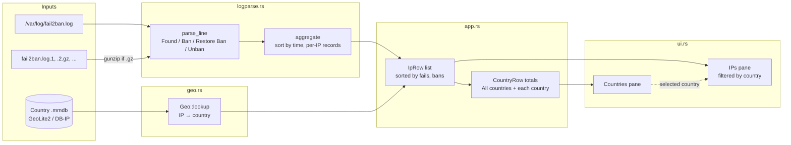
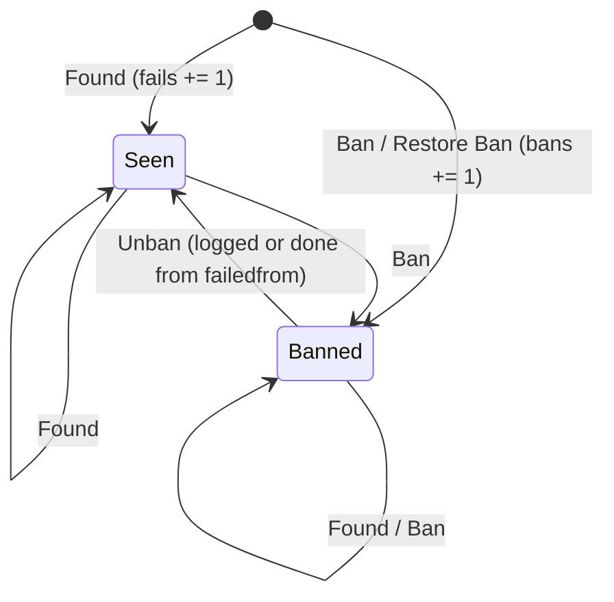
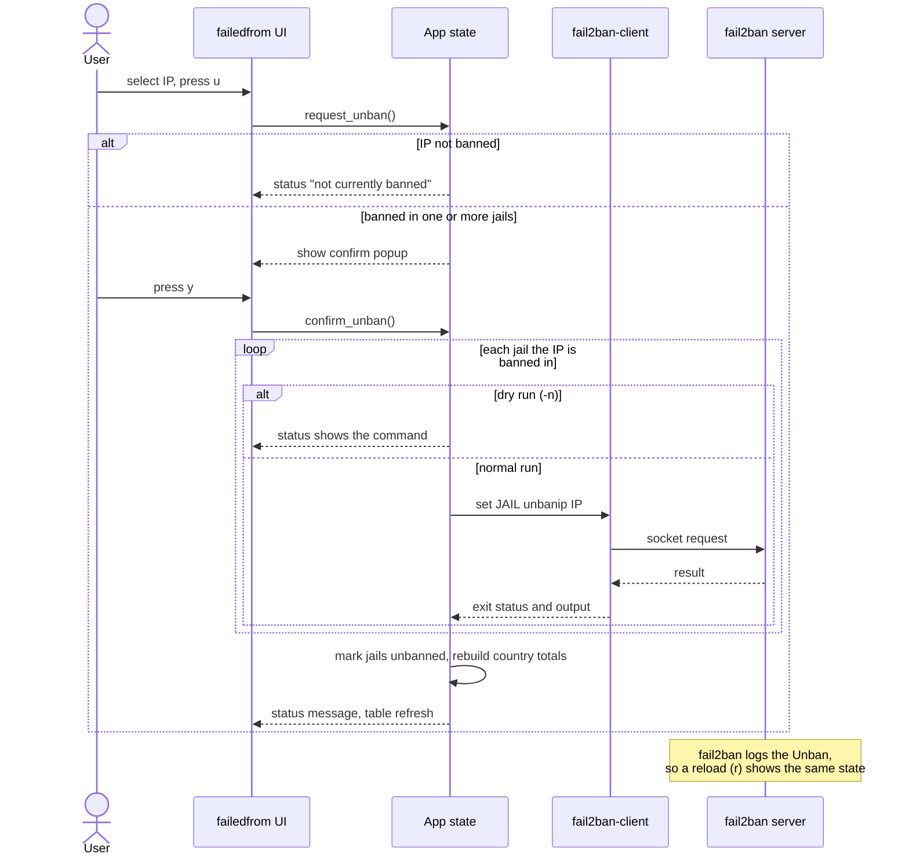
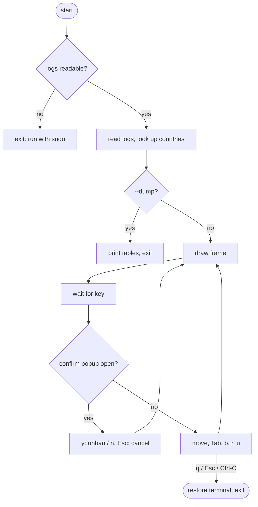

# failedfrom

A terminal UI (built with [ratatui](https://ratatui.rs)) for watching what
`fail2ban` is doing: which IPs failed and got banned, which countries they
come from, and unbanning an IP with a keystroke.

- Reads `/var/log/fail2ban.log` and its rotations (`.1`, `.2.gz`, …).
- Counts `Found` (failures), `Ban` / `Restore Ban`, and `Unban` events per IP
  and jail; an IP is *banned* when its latest Ban in a jail is newer than its
  latest Unban there.
- Aggregates fails, bans, unique IPs, and currently banned IPs per country.
- Unbans through `fail2ban-client set <jail> unbanip <ip>` (once per jail the
  IP is banned in).

## Build

```sh
cargo build --release
```

## Run

The fail2ban log and control socket are root-only, so run it with sudo:

```sh
sudo ./target/release/failedfrom
```

| Option | Meaning |
| --- | --- |
| `-l, --log PATH` | Log file to read; repeatable; `.gz` supported. Default `/var/log/fail2ban.log*` |
| `-g, --geoip PATH` | Country database (`.mmdb`) |
| `--client PATH` | fail2ban client binary (default `fail2ban-client`) |
| `-n, --dry-run` | Show the unban command instead of running it |
| `-d, --dump` | Print the country and IP tables to stdout and exit |
| `-j, --json` | Print all data (totals, countries, IPs with per-jail ban state) as JSON and exit |

### Keys

| Key | Action |
| --- | --- |
| `Tab` / `←` `→` | Switch between the country and IP panes |
| `↑` `↓` / `j` `k`, `PgUp` `PgDn`, `g` `G` | Move the selection |
| `u` | Unban the selected IP (asks for `y`/`n` confirmation) |
| `b` | Show only currently banned IPs |
| `r` | Reload the logs |
| `q` / `Esc` | Quit |

Selecting a country in the left pane filters the IP pane to that country.
The first row, "All countries", shows everything.

## GeoIP database

Countries come from a MaxMind-format country database. Either of these works:

- **DB-IP IP to Country Lite** (no account needed, CC BY 4.0):
  <https://db-ip.com/db/download/ip-to-country-lite>. Download the MMDB
  build and gunzip it.
- **MaxMind GeoLite2-Country** (free account and license key):
  <https://dev.maxmind.com/geoip/geolite2-free-geolocation-data>, or keep it
  updated with `geoipupdate`.

Without `--geoip`, failedfrom picks the first `*.mmdb` file it finds,
preferring names that contain "country", in:

- `/usr/share/GeoIP`, `/var/lib/GeoIP`, `/usr/local/share/GeoIP`
- `/etc/failedfrom`
- `$HOME/.local/share/failedfrom`, and under sudo also
  `/home/$SUDO_USER/.local/share/failedfrom`

Without a database, public IPs show as `??`. Private and loopback addresses
always show as `--`.

## How it works

### Data flow

Log lines become events, events become per-IP records, and each record gets
a country before the totals are shown in the two panes.



### Ban state per IP and jail

Events are processed in timestamp order. An IP is shown as **BANNED** while
at least one of its jails is in the *Banned* state.



### Unbanning an IP



### Event loop



## Trying it without root

```sh
cargo run -- --log tests/fixtures/fail2ban.log --dry-run
```

## License

Copyright (C) 2026 Ronaldo Nascimento

This program is free software: you can redistribute it and/or modify it under
the terms of the GNU General Public License as published by the Free Software
Foundation, either version 3 of the License, or (at your option) any later
version. See [LICENSE](LICENSE).
